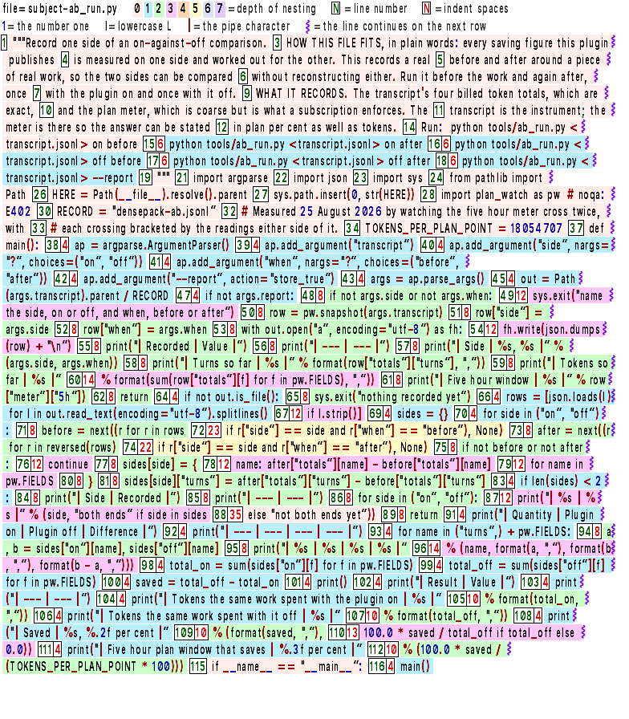

<!-- DensePack 2.0 -->
# How DensePack works

- [What DensePack changes](#what-densepack-changes)
- [How the swap happens](#how-the-swap-happens)
- [What DensePack packs](#what-densepack-packs)
- [The Edit check](#the-edit-check)
- [The image](#the-image)
- [Word files](#word-files)
- [The slash commands](#the-slash-commands)
- [The hooks](#the-hooks)
- [The scripts](#the-scripts)

[INSTALL.md](INSTALL.md) has the install steps. [BENCHMARKS.md](BENCHMARKS.md) has the measurements and the prices. [PLUGIN-FOLDERS-FILES.md](PLUGIN-FOLDERS-FILES.md) lists each folder and working file that the plugin writes.

<br>

---

<br>

## What DensePack changes

DensePack changes some of your files and adds its own folders and packages. The slash command `/dense-remove` undoes these changes. [Remove DensePack](INSTALL.md#remove-densepack) lists what it deletes and which files stay.

| What it changes                                                                                                                                                                                 | What DensePack does                                                                                                                                                                                                                                                                           | Why                                                                                                                                                                                                                                                                                       |
| ----------------------------------------------------------------------------------------------------------------------------------------------------------------------------------------------- | --------------------------------------------------------------------------------------------------------------------------------------------------------------------------------------------------------------------------------------------------------------------------------------------- | ----------------------------------------------------------------------------------------------------------------------------------------------------------------------------------------------------------------------------------------------------------------------------------------- |
| The instruction files: `CLAUDE.md`, `.claude/CLAUDE.md`, `CLAUDE.local.md`, `AGENTS.md` and `.claude/rules/*.md` in a project, your `~/.claude/CLAUDE.md` and the auto memory index `MEMORY.md` | When you run `/bakpack`, DensePack copies the file to `<name>.bakpack` and packs the text into images. It replaces the file with a short pointer that names each image. It converts a file only when the images and the pointer cost less than the text                                              | Claude Code sends these files as text on each turn                                                                                                                                                                                                                                        |
| `~/.claude/settings.json`                                                                                                                                                                       | DensePack adds `"CLAUDE_CODE_THRIFTY_SONIC": "0"` to the `env` block at each session start when the key is not there. On Windows with Git for Windows, it also adds `"EMBEDDED_SEARCH_TOOLS": "1"` and `"CLAUDE_CODE_USE_POWERSHELL_TOOL": "0"`, so that commands and searches run in Bash. DensePack never changes a key that has another value, so to keep a Claude Code default, set the key to another value, such as `"EMBEDDED_SEARCH_TOOLS": "0"`                                                                                                                                                                                       | In auto and bypassPermissions mode, the Claude Code harness can add an instruction to read files with cat or sed. Claude Code turns it on only for some accounts and models. Bash reads save less than Reads. The setting is not in the Claude Code docs. It applies to all your projects |
| `.gitignore` files in `.claude/tmp/` and `.claude/densepack-vault/`                                                                                                                             | DensePack writes one line, `*`                                                                                                                                                                                                                                                                | Those folders contain copies of your files and of command output. The `*` line keeps them out of Git                                                                                                                                                                                      |
| `~/.claude/densepack-state`                                                                                                                                                                     | DensePack creates the folder. It contains the Python path that DensePack found, the seal key `sidecar.key` and the list of converted instruction files. It also contains the images of your `~/.claude/CLAUDE.md` and of each `MEMORY.md`, because those files are outside the project folder | DensePack reads its own notes to find the files that it converted. Cloned repositories can contain a fake copy of those notes. DensePack keeps the real notes in your home folder, where a clone cannot write                                                                             |
| `~/.claude/densepack-cards`                                                                                                                                                                     | Session start packs no card here, because the plugin ships no `instructions` folder. It deletes the folders here that no session used for 7 days                                                                                                                                                                                 | `/dense-remove` deletes this folder when it exists                                                                                                                                                                                                                                        |
| Pillow, freetype-py and NumPy                                                                                                                                                                   | DensePack installs them one time with pip into the data folder of the plugin                                                                                                                                                                                                                  | DensePack needs all three to render an image. It does not change your own Python and needs no password                                                                                                                                                                                    |

<br>

### How the conversion works

- The instruction files are `CLAUDE.md`, `.claude/CLAUDE.md`, `CLAUDE.local.md`, `AGENTS.md` and `.claude/rules/*.md` in a project, your `~/.claude/CLAUDE.md` and your auto memory `MEMORY.md`.
- DensePack converts `AGENTS.md` only when the folder has no `CLAUDE.md`, because Claude Code loads it only then.
- DensePack converts these files only when you run `/bakpack`. It is not automatic, so each user chooses which files become images.
- `/bakpack` with no folder converts the files of this project and its memory index. `/bakpack <folder>` converts the files of another folder, and `/bakpack ~/.claude` converts your personal `CLAUDE.md`.
- Claude Code loads these files at session start, so the session that runs `/bakpack` keeps their text. The next session gets the images.
- `/bak-off` turns converted files back into text. This also works for files that DensePack 2.0.1 or older converted on its own at session start. Those files stay images until you run `/bak-off`.
- DensePack turns each converted file into three kinds of files, the pointer, the `.bakpack` and the images.
- The `.bakpack` contains your original text, byte for byte. Claude Code does not load it, because its name does not end in `.md`.
- DensePack converts a file only when its images and pointer cost less than its text. Short files stay text.
- Instruction files follow the same size limit as other files. See [What are the limits?](#the-limits).
- At session start, DensePack keeps the converted files up to date in the background. It converts no new file. The session does not wait for it.
- The images can cost one extra turn at the start of a session. DensePack does not count that turn when it compares the costs. For that reason, short sessions can cost more with a converted file.
- To change your instructions, edit the `.bakpack`. DensePack converts it again at the next session start.
- DensePack moves text that you add below the pointer into the `.bakpack` at the next session start. It moves new lines from auto memory the same way.
- If you replace a pointer with a new file, DensePack converts the new file. Your old text moves to `.bakpack.old-N`, so nothing is lost.
- Haiku sessions read the `.bakpack` as text because Haiku does not read the text in an image correctly.
- Auto memory keeps working. DensePack sets no flag that stops it.
- In a shared repository, commit the `.bakpack` with the pointer. Teammates without DensePack get the pointer but not its images. The images are in `.claude/densepack-vault/`, which Git does not commit. It is not tested whether their model then reads the `.bakpack`.

### Working file cleanup

Session start deletes old working files. DensePack keeps the vault under its size cap. [Vault cleanup](PLUGIN-FOLDERS-FILES.md#vault-cleanup) and [Lock files](PLUGIN-FOLDERS-FILES.md#lock-files) give the ages and the cap.

<br>

---

<br>

## How the swap happens

The hooks make the swap before and after the tool call.

1. The agent calls the Read tool on a file.
2. The Read runs on the real file. Claude Code records the Read. Later Edits of the file work.
3. After the Read, `read_image.py` packs the file into images or reuses the images from an earlier pack. If the images cost fewer tokens than the text, they replace the text in the tool result.
   - Files of more than one image return one image when it fits with no resize. The image contains all the pages, one page below the other.
   - Otherwise a whole-file Read returns its images in one result, in page order. Like a text Read, it stops at line 2,000. The note gives the lines of each image.
   - Reads of a line range get images of only those lines. All the images of the range come back in one result, the same as the text of the range.
   - Files of two full pages do not fit in one image.
4. The model receives the image, not the text. Anthropic bills only what reaches the model.

- DensePack never puts two pages side by side in one image.
  - In a DensePack 1.0 bench of 16 files, Sonnet 5 answered 3 of 5 correctly from pages side by side. It answered 5 of 5 from pages one below the other, the same as Opus 5.
  - In DensePack 1.0, the pages of `drop_read_gate.py` cost 7,224 tokens side by side and 7,168 tokens one below the other.
- Reads of 20 lines or fewer stay text. The agent uses them to copy exact text, such as a hash or the old text of an Edit.

Bash output takes the same route.

1. The Bash command runs.
2. `bash_image.py` runs after the command. It packs output of 400 characters or more into images when the images cost fewer tokens than the text. [What are the limits?](#the-limits) gives the reason for the 400-character floor.
3. The model receives all images of the output in the same result. `bash_image.py` puts the images in the `structuredContent` field of the Bash result. Claude Code sends that field to the model as the tool result. The model gets the whole output in one call, the same as with text. The text of the output stays in `.claude/densepack-vault/images/bash-output-<id>.txt`.
   - PowerShell results contain only one image. For longer PowerShell output, the result contains image 1 and a note that names the other images. The model Reads the images that it needs.
4. Some kinds of lines are easy to misread in an image. The hook copies those lines with their line numbers as exact text into the note of the same result. If the images and those lines cost more than the text, the output stays text. These lines count:
   - The line contains an ID of 8 or more letters and digits with a capital I or a small l. In a test, Opus 5.5 typed 76 of 108 such IDs wrong, because I and l are drawn the same. Only IDs that mix capitals, small letters and digits count. Words with a number, such as `Makefile2`, do not count.
   - The line contains 8 or more letters in random case with a capital I or a small l.
   - The line contains `git --stat` bars.
   - The line is a row of dash rules, as `pip list` prints them.
   - The line contains a number of 18 or more digits.
   - The line contains only spaces or tabs.
   - The line contains a tab inside it. Tabs right after a line number, as `cat -n` and `nl` print them, do not count.

Grep and Glob results always stay text. Claude Code sends them to the model as text only, so no hook can replace them with an image. On macOS, Linux and WSL, Claude Code leaves Grep and Glob out of the default tools. The agent searches with `grep` and `find` in Bash. DensePack packs that output. On Windows, Claude Code gives the agent Grep, Glob and a PowerShell tool. [Install the plugin](README.md#install-the-plugin) shows the two settings that make Windows search and run commands in Bash too.

### Subagent images

Agents write their briefs and reports as text. DensePack swaps that text for images when the images cost less than the text. The receiving agent gets one short line that names the image. It opens the image with the Read tool.

- Hooks can change the prompt of an Agent call and the result of the Agent tool only as text.
- In a test, a hook put an image into the Agent result in four different shapes. In all four, the main agent (the lead) got the original text.
- Read results and Bash results can carry an image.

These steps run when the lead gives a task to a subagent.

1. The lead writes the task as text in the Agent call.
2. Before the subagent starts, `brief_pack.py` finds the model of the subagent. It uses the model field of the Agent call first. Then it uses the model line of `.claude/agents/<type>.md`. General-purpose subagents with neither get the model of the agent that calls them.
3. The task stays text when that model gets text, such as Haiku or Sonnet after `/max-off`. It also stays text in these cases:
   - The custom agent type has no model that DensePack can find, so DensePack cannot check whether it gets images.
   - The task has fewer than 1,000 characters.
   - Code blocks are more than half of the task, because the subagent needs code as exact text.
   - The permission mode is not auto or bypassPermissions. See [Permission modes](#permission-modes) for the reason.
4. Otherwise `brief_pack.py` packs the task into images and moves its code blocks to a numbered text file beside the images. It puts a short line that names the image in place of the task. It does this only when the plugin calculates that the images save more than they cost.
5. The subagent receives the DensePack session note first and that line second.
6. If the task names small files, the line lists up to 5 of them to Read with the image. The image then costs no extra turn. Files over 100 KB stay out, because the task can name a file that the subagent does not need. When the task names no such file, the subagent spends one turn on the Read of the image. `brief_pack.py` packs the task only when the images save more than that turn costs.

These steps run when a subagent returns its report to the lead.

1. The subagent writes its report as text in its last answer. It takes no extra turn for DensePack unless it runs in the background.
2. When the subagent stops, `subagent_stop.py` packs the report into images. The lead needs one extra turn to Read them, so `report_pack_worth()` checks that the saving covers that turn. Reports also stay text when the lead gets text or when code blocks fill more than half of the report.
3. After the Agent call, `report_swap.py` replaces the report in the Agent result with one line that names the report file. `pointer.py` adds a note that names the images and marks them as the full report, not a summary.
4. The lead opens each report image with its own Read call. It can read all of them in one turn.

When Claude Code changes the text of the Agent result, `report_swap.py` does not replace the result. One example is a note in front of the report. The lead then keeps the report as text, with a note not to Read the image.

`subagent_stop.py` blocks the first stop of each background subagent with a request for the line that names its report file.

- Background subagents return their reports in a message, which no hook can change.
- That reply is one more turn, for which Claude Code sends the whole context of the subagent again.
- `subagent_stop.py` sends that request only when the images of the report also save more than that turn costs. Otherwise the report stays text.

Claude Code sends the SessionStart note to the lead only. `subagent_start.py` sends each subagent the "DensePack is on" line and the rules when it starts.

- After `/max-off`, Sonnet subagents get no note, because they never get an image. Subagents with an unknown model still get the note, because most agents run on a model that gets images.
- Haiku subagents get no note, because their files and command output stay text.

### The session start note

Session start runs when a session starts and again after a resume, `/clear` or `/compact`. `bootstrap.py` then sends the lead a note of about 2,300 tokens.

- Its first line is "DensePack is on." Subagents get the same line.
- It contains the rules for less code and short replies, from `plugin/rules/STYLE-RULES.md`. Subagents get these rules too, and the lead learns this from the note. Haiku subagents, and Sonnet subagents after `/max-off`, get no note and no rules. The lead then leaves the rules out of a task.
- It names an image of the project map: each folder, its files and the names that each file defines. The lead reads that image in its first turn. When the map has under 400 characters, the same floor as Bash output, the note contains it as text.

The guidance for images goes beside the first image of each session and each agent, about 25 tokens one time:

- Files and command output arrive as images of the same text.
- The images have a legend of their marks. [The image](#the-image) lists them.

The guidance for images contains no rules about Reads, because such rules made the agent read differently than with text. [CHANGELOG.md](CHANGELOG.md) has the measured runs.

The start note has a few rules on reading, such as to read a short file whole and to batch reads in one turn.

- Claude Code names no model when a new session starts, so every new lead gets the note, even on Haiku or after `/max-off`. After a resume or `/compact`, DensePack reads the model from the transcript, so a Haiku lead or a `/max-off` Sonnet lead gets no note.
- If Pillow, freetype-py or NumPy is missing, DensePack packs nothing. The lead gets a warning instead of the note, with the pip command that installs the three libraries. The warning also shows on your screen.
- Subagents still get the note then, because `subagent_start.py` does not check for the libraries. Their files and command output stay text.

Session start also shows these notes on screen.

- One note is about the settings that DensePack set in `~/.claude/settings.json`: CLAUDE_CODE_THRIFTY_SONIC, and on Windows the two Bash settings. When DensePack cannot write that file, the note shows the lines to add. DensePack converts Bash and PowerShell output of 400 characters or more. Shell reads still cost a little more than Reads.
- One note is about the instruction files that DensePack converted.
- The totals table of the last conversation shows when receipts are not quiet.
- Warnings show when Pillow, freetype-py or NumPy is missing and the install failed.

### Folder files

If your prompt names a folder by its full path, `prompt_card.py` packs its files in the background. The agent gets no list of the files. It explores the folder with `ls`, Glob or Grep, the same way as with text. Then it reads the same parts of the same files. "This folder", "the current folder", "the project folder" and the same words with "directory" work the same way.

- "This folder" means the folder that Claude Code works in.
- Folders must be at least two levels below the root, such as `C:\Users\me`. This rule applies to "this folder" too.
- The hook splits the prompt at spaces, quotes, commas and semicolons. For that reason it does not find a folder path that contains a space.
- The hook packs at most 4 folders for one prompt. It packs only the files directly in the folder. It skips hidden files, whose names start with a dot.
- Large folders get no background pack. See [What are the limits?](#the-limits).

The background pack packs several files at a time.

- It stops when the files are too large in total. [What are the limits?](#the-limits) also gives these byte limits.
- Reads of those files wait for that job for up to 300 seconds. They get the same images. Those Reads do not pack the files again.

With "this folder", the background pack can still pack the Word files of that folder. `prompt_card.py` lists their images only when you give the full folder path. See [Word file packing](#word-file-packing).

<br>

---

<br>

## What DensePack packs

DensePack packs the files that the agent Reads and the output of Bash commands. It also packs Word files, the briefs and reports of subagents and instruction files such as `CLAUDE.md` and `MEMORY.md`.

Before it sends an image, DensePack compares the price of the image with the price of the text. It sends the text when the image costs more.

- For a file, Bash output, a Word file and an instruction file, DensePack compares tokens only. The image costs its patches and its note, as [The image](#the-image) shows. The text costs one token for each 2.4 characters. The test is the same for each model, because each model gets the same image.
- For a brief, DensePack also compares tokens. When the subagent must spend a turn only to Read the image, DensePack adds the cost of that turn. It counts that turn as 30,000 tokens of context plus 100 output tokens at 5x the input price. In a measurement of 11 subagents on Opus 5.5, that turn read about 30,000 tokens and wrote 16 to 195. The context uses the cache read share of the model that the Agent call names. When the call names none, it uses the share of the lead model.
  - The share is 0.025 on Fable 5.1 and 0.05 on Opus 5.5 and Sonnet 5.5.
  - Other models get 0.1, the highest share. Model names with no version, such as `opus`, also get 0.1, the safe choice when the price is unknown.
  - DensePack counts the saving at the 5-minute cache write price, 1.25x the input price.
- Subagent reports become images only when the images save money. The image makes each later turn of the lead cheaper. It also costs the lead one extra turn to open it. Background subagents also need one more short reply.
- DensePack prices those turns at the rates of each model in [BENCHMARKS.md](BENCHMARKS.md#how-anthropic-bills). Haiku never gets images. Haiku subagents can still write reports for Opus or Fable leads, which is why the code has Haiku prices. Models other than Fable, Opus, Sonnet and Haiku get the Sonnet prices.
- The report must also save more tokens than the Read of the lead costs.

These files and outputs stay text. [What are the limits?](#the-limits) gives each size limit and the reason for it.

- Files in a `.claude` folder and files in the scratchpad folder of Claude Code stay text. DensePack still packs Word files in these locations. It also packs files in Claude Code worktrees under `.claude/worktrees/`.
- Only the stdout of a Bash command packs. The stderr stays text beside the images.
- The output of interrupted commands stays text.
- The PowerShell tool drops error text next to an image. DensePack puts that error text in its note beside the image.
- All files, output, briefs and reports stay text for agents on a model that gets text, such as Haiku.
- All files, Bash output, briefs and reports stay text when Pillow, freetype-py or NumPy is missing.

### The limits

There are four kinds of limits:

| Kind | What it means |
| --- | --- |
| Price | On the other side of the limit, the image costs more tokens than the text. |
| Measured | In a bench, the model made more mistakes on the other side of the limit. |
| Claude Code | Claude Code or Windows sets the limit. DensePack cannot change it. |
| Choice | DensePack picked the number. You can change it in the named file in `plugin/scripts/`. |

| Limit                                                                                                                   | Why                                                                                                                                                                                                                           | Kind                                                                          |
| ----------------------------------------------------------------------------------------------------------------------- | ----------------------------------------------------------------------------------------------------------------------------------------------------------------------------------------------------------------------------- | ----------------------------------------------------------------------------- |
| Files whose images cost more tokens than their text stay text                                                           | DensePack prices the image and the text of each file. One example is a Markdown file with one wide table row                                                                                                                  | Price                                                                         |
| Bash output under 400 characters stays text                                                                             | Below about 330 characters, the image costs more than the text. The price check is not exact near that point, so the floor is 400                                                                                             | Price                                                                         |
| The output of a Bash command that exits with an error stays text                                                        | Claude Code sends a failed command to the `PostToolUseFailure` hook, and DensePack's `PostToolUseFailure` hook handles only Read                                                                                               | Claude Code                                                                   |
| Early in a conversation, subagent reports under about 2,100 tokens on Opus and Sonnet, and under 1,500 tokens on Fable, stay text              | The main agent needs an extra Read for the image. That Read rereads the whole conversation. The floor rises as the conversation grows. At 200,000 tokens of context and 20 turns, it is about 7,300 tokens on Opus and Sonnet | Price                                                                         |
| Subagent briefs under 1,000 characters stay text                                                                        | Agents that got a shorter brief as an image sometimes copied it out or failed the task                                                                                                                                        | Measured                                                                      |
| Haiku and unknown models get text                                                                                       | Haiku 5.5 got about 95% of the bench checks right from images. Its misses were code facts, such as which script imports which                                                                                                 | Measured                                                                      |
| Files and Bash output over 1,000,000 bytes stay text                                                                    | The pack takes about 0.15 s per 1,000 characters, so 1,000,000 bytes waits about 150 s on the first Read. You can raise it on a faster computer                                                                               | Choice: `READ_MAX_BYTES` in `drop_read_gate.py`                               |
| Files stay text when the font has no glyph for more than 2% of their non-space characters                                    | Characters that the font cannot draw become boxes, such as in Chinese, Japanese or Korean text                                                                                                                                | Choice: `MISSING_GLYPH_MAX` in `freetype_glyph.py`                            |
| Reads of 20 lines or fewer stay text                                                                                    | The agent gets the exact text of the lines before an Edit                                                                                                                                                                     | Choice: `LINE_PULL_MAX` in `common.py`                                        |
| Folders in your prompt with more than 200 files are not packed in advance. The advance pack also stops at 700,000 bytes | The agent rarely reads that many files. 700,000 bytes is about 105 s of packing                                                                                                                                               | Choice: `LIST_MAX_FILES` in `prompt_card.py` and `BURST_BYTES` in `common.py` |
| The conversation folders in `.claude/densepack-vault` use 200 MB or less. Other vault images are deleted after 7 days.    | 200 MB contains about 10,000 packed reports                                                                                                                                                                                   | Choice: the `vault_mb` setting                                                |
| Empty files and files with a null byte stay text                                                                        | Empty files have nothing to draw. Null bytes mark binary files                                                                                                                                                                | Choice: `_drawable_text()` in `drop_read_gate.py`                             |
| Edit and Write do not work on Word files                                                                                | The Read tool cannot open Word files. The agent gets a note and reads the text with a shell command                                                                                                                           | Claude Code                                                                   |
| Bash output stays text when your shell shows a password prompt as it opens                                              | All Bash commands wait for the password. [Install walkthrough](INSTALL.md#install-walkthrough) has the steps                                                                                                                  | Claude Code                                                                   |
| DensePack does not run when a company policy blocks PowerShell scripts                                                  | On Windows without Git for Windows, the hooks start through PowerShell scripts                                                                                                                                                | Claude Code                                                                   |

### The size limit

DensePack does not pack files over 1,000,000 bytes. The agent reads them as text. DensePack saves nothing on them.

- Word files over the limit get no images. The Read tool cannot open them either. DensePack sends the agent a note with the reason and a reminder to use a shell command.
- The same limit applies to Word files and to Bash output. For Word files, DensePack measures the text in the file, not the size of the file. For Bash output, it counts the characters.

To pack a larger file, raise the limit and accept the wait. Paste this line into Claude Code.

```
Raise DensePack's READ_MAX_BYTES to 2000000
```

- `READ_MAX_BYTES` is a number in the file `scripts/drop_read_gate.py` of the installed plugin in `~/.claude/plugins/cache/densepack-marketplace/densepack/<version>`.
- It is not a setting. Claude Code edits the number in that file when you paste the line.
- DensePack does not run the copy in the marketplace folder.
- Plugin updates replace the file. Make the change again after each update.

### Pack times

DensePack packs a file into images the first time the agent reads it.

- DensePack saves the images of the whole file. Later Reads of the whole file are fast.
- Reads of part of a file get a new pack each time, because DensePack reuses only whole-file images.
- After a change to the file or a new plugin version, DensePack packs the file again.
- At session start, DensePack deletes images older than 7 days and packs those files again at their next Read.
- The Read tool of Claude Code rejects files over 256 KB. DensePack still packs those files. The agent gets a note with the names of the images. The agent opens the first image with one more Read.

The pack times come from tests on one computer. The wait is longer when DensePack packs files in other sessions at the same time.

| File size           | First wait       |
| ------------------- | ---------------- |
| 4,453 bytes         | 1.0 seconds      |
| 22,024 bytes        | 1.4 seconds      |
| 94,618 bytes        | 4.9 seconds      |
| 127,466 bytes       | 8.1 seconds      |
| about 300,000 bytes | 14 to 17 seconds |

The wait increases with the size of the file.

### Cost of each part

Claude Code sends the whole conversation with each request. The earlier part comes from the cache at the cache read price.

- Claude Code writes each new token of the lead to the 1-hour cache. Anthropic bills that token at 2x the input price.
- Claude Code writes the new tokens of a subagent to the 5-minute cache, at 1.25x the input price.
- The cache read price is 0.05x the input price on Sonnet 5.5 and Opus 5.5 and 0.025x on Fable 5.1.
- Output tokens cost 5x the input price.

DensePack adds these tokens to a session, apart from the image, whose size changes with each file.

| What DensePack adds                  | When                                                                                                        | Cost in the first turn                                                                                                                       | Cost in each later turn                                                                             |
| ------------------------------------ | ----------------------------------------------------------------------------------------------------------- | -------------------------------------------------------------------------------------------------------------------------------------------- | --------------------------------------------------------------------------------------------------- |
| The session start note               | It goes to the model one time at each session start, which also runs after a resume, `/clear` or `/compact` | It adds about 2,300 tokens at the cache write price                                                                                          | It adds the same tokens at the cache read price                                                     |
| The project map                      | The lead reads it in its first turn                                                                         | The image costs 466 tokens for 24 scripts and 1,133 for a FastAPI and React repo, plus one Read call                                       | It adds the same tokens at the cache read price                                                     |
| The guidance for images              | It goes one time beside the first image of each session and agent                                           | It adds about 25 tokens at the cache write price                                                                                             | It adds the same tokens at the cache read price                                                     |
| The session start note in a subagent | It goes one time to each subagent                                                                           | It adds the line "DensePack is on." and the rules, about 2,090 tokens                                                                        | It adds the same tokens at the cache read price                                                     |
| Reads of files that fit one image    | They happen on each Read                                                                                    | They add nothing, because the hook replaces the result and adds no text                                                                      | They add nothing                                                                                    |
| Bash output packed as images         | It happens on each packed output                                                                            | One image adds nothing. Longer output adds a short label for each image and a note. Lines that a model can misread add their exact text      | It adds nothing when the hook adds no note. Otherwise it adds the same note at the cache read price |
| Packed briefs                        | It goes to a subagent in place of a brief of 1,000 characters or more                                       | It adds about 160 tokens and one Read call                                                                                                   | It adds the 160 tokens at the cache read price in each turn of the subagent                         |
| Packed reports                       | It goes to the lead in place of a long subagent report                                                      | It adds about 56 tokens and one Read call                                                                                                    | It adds the 56 tokens at the cache read price in each later turn                                    |
| The legend card                      | It goes one time with the first message that contains a pasted image                                        | It adds 360 tokens on Sonnet 5.5                                                                                                             | It adds the same tokens at the cache read price                                                     |

The session start note adds about 2,300 tokens. At that count, it costs this much in the 1-hour cache.

| Model      | Cost in the first turn | Cost in each later turn |
| ---------- | ---------------------- | ----------------------- |
| Opus 5.5   | $0.018                 | $0.0005                 |
| Sonnet 5.5 | $0.009                 | $0.0002                 |
| Fable 5.1  | $0.046                 | $0.0006                 |

When a part goes to the model a second time, Anthropic bills it as new again.

- When the agent Reads the same file a second time, DensePack uses the saved image. Anthropic bills it at the cache write price again, because it is new at the end of the conversation.
- The same is true when the agent runs the same command a second time.
- The lower price applies only to the tokens that an earlier turn sent.

<sub>The first row compares two `claude -p` sessions on Opus 5.5 with no tool call, with DensePack off and on. The Read and Bash rows come from the code of `read_image.py` and `bash_image.py`, not from a measured session. The token counts come from the `usage` rows of each transcript. The dollars use the prices in [BENCHMARKS.md](BENCHMARKS.md#how-anthropic-bills).</sub>

| What DensePack packs                                        | When                                                                                                  |
| ----------------------------------------------------------- | ----------------------------------------------------------------------------------------------------- |
| Briefs that go to subagents                                 | DensePack packs them before the subagent starts, only in auto and bypassPermissions mode              |
| Subagent reports                                            | DensePack packs them when the subagent finishes                                                       |
| Files that the Read tool reads                              | DensePack packs them after the Read runs                                                              |
| Bash and PowerShell output of 400 characters or more        | DensePack packs it after the command runs                                                             |
| The instruction files, such as `CLAUDE.md` and `MEMORY.md`  | DensePack packs them in the background at session start. The next session uses the images             |
| Files that you copy into `.claude/densepack-vault/to-pack/` | DensePack packs them after the next tool call. The file and its images then move to `to-pack/packed/` |

| File type                                               | Reads as an image                                                                                                                                                                                                                                                                                                                             |
| ------------------------------------------------------- | --------------------------------------------------------------------------------------------------------------------------------------------------------------------------------------------------------------------------------------------------------------------------------------------------------------------------------------------- |
| Text with accents, dashes, Greek letters and math signs | Yes                                                                                                                                                                                                                                                                                                                                           |
| Prose, such as reports, briefs and shell output         | Yes. Agents send each other images of their reports and briefs                                                                                                                                                                                                                                                                                |
| Python `.py`                                            | Yes.<br><br>Opus 5.5 rebuilt the file byte identical in 73 of 100 runs. In 10 more rebuilds, Opus 5.5 got each word right and the code ran the same each time. Five of those 10 were byte identical. Sonnet 5.5 managed the same in 8 of 10, with 1 byte identical. In the bench of DensePack 1.0, Fable 5.1 matched 99.83% of the characters |
| HTML `.html`                                            | Yes.<br><br>Opus 5.5 rebuilt the file byte identical in 63 of 100 runs. In the bench of DensePack 1.0, Fable 5.1 matched 99.99% of the characters                                                                                                                                                                                             |
| Markdown `.md`                                          | Yes.<br><br>Opus 5.5 rebuilt the file byte identical in 100 of 100 runs. In the bench of DensePack 1.0, Fable 5.1 rebuilt all the words                                                                                                                                                                                                       |
| GDScript `.gd`, with tab indents                        | Yes.<br><br>Opus 5.5 rebuilt the file byte identical in 65 of 100 runs                                                                                                                                                                                                                                                                        |
| Go `.go`, with tab indents                              | Yes.<br><br>Rebuilds of Go files are not measured yet                                                                                                                                                                                                                                                                        |
| Markdown with a wide table row                          | Only when its images cost less than its text, the same as other files. In a DensePack 1.0 test, a Markdown file with one wide table row needed 30 images. The plugin sent the text, because those images cost more                                                                                                                            |
| Word `.docx` and `.doc`                                 | Yes. The Read tool of Claude Code cannot open a Word file. DensePack reads the words and packs them in the same turn as other files. [The size limit](#the-size-limit) shows how to raise the limit                                                                                                                                           |
| JSON, CSV, YAML                                         | These types are not measured yet                                                                                                                                                                                                                                                                                                              |
| Haiku, all files                                        | No. Haiku gets text                                                                                                                                                                                                                                                                                                                           |
| Sonnet, all files                                       | Yes. Type `/max-off` to send Sonnet text                                                                                                                                                                                                                                                                                                      |
| Chinese, Japanese and Korean text                       | No. The Inter font has no glyphs for these characters                                                                                                                                                                                                                                                                                         |

<sub>Byte-identical rebuilds test how exact a copy from an image can be. They are not normal tasks. See [Byte-identical rebuilds](#byte-identical-rebuilds).</sub>


<br>

---

<br>

## The Edit check

Claude Code rejects an Edit when the old text is not in the file, or is in it more than once without replace_all. `edit_gate.py` blocks the same two kinds of Edit. Its message contains the exact lines of the file, so the agent can fix the Edit at once.

On Claude Code 2.1.296, `edit_gate.py` runs first, so you get its message.

It blocks each Edit whose old text does not match, also a typo that has nothing to do with images. Those Edits would fail without DensePack too, with "String to replace not found in file". On Claude Code 2.1.280 to 2.1.295, Claude Code checked first, and `edit_gate.py` never got these Edits.

- Reads of 20 lines or fewer return exact text. For example, a Read with offset N returns the lines from the green line number N of the image.
- When an Edit fails, the agent Reads those lines as exact text and sends the Edit again.
- Agents can copy a line break to the wrong place when they copy a block from an image. Then the Edit fails.
- In five bug-fix and feature tasks, Opus 5.5 copied 12 of 103 lines wrong from images into Edits. From text, it copied all 44 lines right.

<br>

---

<br>

## The image

> `pack_code()` in `plugin/scripts/codepack.py` packs the text of each page. `composite_grid()` in `plugin/scripts/densepack.py` joins the pages of one file into one image, when the joined image fits with no resize.
>
> The image is the same PNG for each model. The renderer tests 8 widths from 700 to 952 pixels, each a multiple of the 28-pixel patch. It uses the width that costs the fewest tokens.
>
> - Files of 60,000 bytes or more pack in several processes at the same time. The processes split the pages between them.
> - The pages are the same as the pages from one process.
> - When one turn Reads more than two files, each file packs in one process.

<br>

<p align="center">
  
</p>

<br>

| Text color | Characters       |
| ---------- | ---------------- |
| Black      | Letters          |
| Blue       | Digits           |
| Red        | Most other marks |

<br>

| Mark                                   | What it shows                                                                                                                                                                                                         |
| -------------------------------------- | --------------------------------------------------------------------------------------------------------------------------------------------------------------------------------------------------------------------- |
| Colored bands behind a line            | The band contains the text of that line. In a tab-indented file, the band color is the tab count of the line. Space-indented files use one band color                                                                 |
| Green numbers in a box                 | The line with that number starts here. Lines can start in the middle of a row                                                                                                                                         |
| Gaps in the green numbers              | The gaps mark blank lines                                                                                                                                                                                             |
| Green `N\n` boxes before a line number | These boxes mark N blank lines before that line                                                                                                                                                                       |
| Red numbers in a box                   | Red numbers count spaces. After the green number, the red number is the indent of the line. Inside a line, it counts a run of 2 or more spaces. It also counts the spaces at the end of a line. Red 0s mean no spaces |
| One blue `\t` in a box                 | The box marks 1 tab                                                                                                                                                                                                   |
| Blue `\t` then red `\t`                | The two boxes mark 2 tabs                                                                                                                                                                                             |
| Blue `N\t` boxes                       | These boxes mark N tabs, for 3 tabs or more                                                                                                                                                                           |
| Purple marks at the right edge         | The line continues on the next row                                                                                                                                                                                    |
| The top one or two rows of the image   | These rows contain the key to the colors and marks. The name of the file is at the top right                                                                                                                          |

DensePack 1.0 made this image of a Python file of 116 lines. The current code packs the same file at 896 by 728 pixels, for 834 tokens.

| The image above   | Value                                                                                                                                             |
| ----------------- | ------------------------------------------------------------------------------------------------------------------------------------------------- |
| What it contains  | All the characters of a Python file                                                                                                               |
| Size of that file | 4,461 characters of Python                                                                                                                        |
| Pixels            | 784 by 896                                                                                                                                        |
| Cost as an image  | 896 visual tokens                                                                                                                                 |
| Cost as text      | 1,859 tokens                                                                                                                                      |
| Score             | In the DensePack 1.0 bench of 100 runs, Fable 5.1 and Opus 5 answered 5 of 5 in each run. Sonnet 5 answered 5 of 5 in 99 runs and 4 of 5 in 1 run |

The font is Inter SemiBold at 17 px, the same size for each model. `CODE_PX` in `plugin/scripts/common.py` sets that size. The environment variable `DENSEPACK_CODE_PX` changes it.

- FreeType draws each character as a gray mask, which Pillow then writes into the PNG.
- The renderer narrows letters to 10/17 of their full width.
- Digits, brackets, the lowercase l, the comma and the marks %, # and ? keep 12/17 of their width. The double quote keeps 11/17 of its width. The single quote keeps 2/3 of its width.

For each file, the plugin sends the text when the text costs fewer tokens than the image.

- Anthropic bills an image by patches of 28 by 28 pixels.
- The plugin adds 2 tokens for each image. In a test of 28 packed images, each image cost its patch count plus 2.
- Images of 784 by 896 pixels are 896 patches, which the plugin counts as 898 tokens.
- Text costs about one token for each 2.4 characters.

### Size limits of the image

DensePack keeps each image at 1,596 pixels or less on each side, under all the size limits below. The PNGs are also 250,000 bytes or less, below the 307,200 bytes at which Claude Code converts a PNG to a JPEG.

| Limit                                                       | Where                                                                                      | What happens above the limit           |
| ----------------------------------------------------------- | ------------------------------------------------------------------------------------------ | -------------------------------------- |
| 2,576 pixels on the long edge or 4,784 tokens               | Anthropic API, for Claude 4.7 and later models, such as Fable 5.1, Opus 5.5 and Sonnet 5.5 | The API shrinks the image              |
| 2,000 pixels on a side, in a request of more than 20 images | Anthropic API                                                                              | The API rejects the image              |
| 2,000 pixels on a side                                      | Claude Code                                                                                | Claude Code shrinks the image          |
| 512,000 bytes, or 307,200 bytes on some connection types    | Claude Code Read tool                                                                      | Claude Code converts the PNG to a JPEG |

<sub>The API limits are from the Anthropic [vision docs](https://platform.claude.com/docs/en/build-with-claude/vision) on 8 October 2026. The API itself accepts base64-encoded PNGs up to 10 MB. The [Claude Code tools reference](https://code.claude.com/docs/en/tools-reference) states the JPEG conversion over 500 KB. The 307,200-byte limit and the 2,000-pixel limit were constants in the Claude Code 2.1.295 program, checked on 8 October 2026.</sub>

- Shrunk images can make small text hard to read. JPEG compression blurs the edges of the letters. In a DensePack test, a JPEG changed 96% of the pixels of a code page.
- The largest page in a test of 32 repo files was 952 by 1,428 pixels.
- DensePack joins the pages of a Read into one image when they fit in 1,568 by 1,568 pixels. Otherwise a whole-file Read returns its images in one result. Like a text Read, it stops at line 2,000. The largest joined image costs 3,136 tokens.
- The pages have about 13 main colors for the background, the bands and the letters. The rest are soft shades on the letter edges, which bring a full-color page to 727 to 1,185 colors.
- In a test of 203 pages, 173 pages needed 256 colors to stay under 250,000 bytes. The other 30 pages stayed in full color.
- 256 colors changed 0.02% of the ink pixels of one tested page. The accuracy of full color against 256 colors is not measured yet.
- In a test of 195 pages, each page over 1,000,000 pixels was over 250,000 bytes in full color. DensePack therefore saves pages of more than 1,041,666 pixels in 256 colors right away. That skips a full-color save of about 0.4 seconds that ends over the cap anyway.

<br>

---

<br>

## Word files

DensePack packs `.doc` and `.docx` files into images when they contain words and the images cost less than the text. These Word files cost one turn, the same as other files whose pages fit in one image.

Two hooks find Word files, `prompt_card.py` and `pointer.py`. They miss Word files in these places.

- The Word file shows only as a relative path in a tool result.
- The Word file is only in a folder that the prompt calls "this folder".

Word files take a different route because the Read tool of Claude Code does not open Word files.

When a Word file gets no images, the agent has nothing it can Read. For each such file in the prompt, `prompt_card.py` sends a note with the reason. The agent then reads the text with a shell command. `pointer.py` sends the same note only when a pack fails.

- `prompt_card.py` estimates the time of each pack from the size of the text. It uses 0.3 seconds for each 1,000 bytes, which is twice the slowest measured rate.
- It starts a pack only when that estimate ends at least 2 minutes before its 30-minute hook timeout. Otherwise the agent gets a note that the pack ran out of time.

| Step                            | `.docx`                                                                                                                                                                                                                                                                                                                                                                                  | `.doc`                                                                                                                                                                 | All other files                                                                             |
| ------------------------------- | ---------------------------------------------------------------------------------------------------------------------------------------------------------------------------------------------------------------------------------------------------------------------------------------------------------------------------------------------------------------------------------------- | ---------------------------------------------------------------------------------------------------------------------------------------------------------------------- | ------------------------------------------------------------------------------------------- |
| **File format**                 | It is a zip of XML                                                                                                                                                                                                                                                                                                                                                                       | It is an OLE2 container, a small file system of streams                                                                                                                | They are plain text on disk                                                                 |
| **How DensePack gets the text** | `pointer.docx_text()` unzips it, reads `word/document.xml` and reads each `<w:p>` paragraph node. It puts each table row `<w:tr>` on one line, with a pipe character between the cells                                                                                                                                                                                                   | `pointer.doc_text()` opens the OLE2 streams and reads the `WordDocument` stream. Then it reads the piece table in the `Table` stream to put the bytes in reading order | DensePack needs no step, because the bytes are the words                                    |
| **Text copy**                   | DensePack writes a text file for each Word file in `.claude/densepack-vault/images/`. Its name comes from a copy of the Word file in `.claude/tmp`, for example `.claude-tmp-densepack_word_8d36c710126a.docx.txt`. It contains the exact text that the images show. The images take its name, for example `.claude-tmp-densepack_word_8d36c710126a.docx.txt-image-1-of-1-DensePack.png` | The text copy is the same, with `.doc.txt` at the end of the name                                                                                                      | DensePack makes no copy, because the file is the text                                       |
| **Library**                     | DensePack uses `zipfile` and `xml.etree` from the standard library                                                                                                                                                                                                                                                                                                                       | DensePack parses the bytes by hand with `struct` from the standard library                                                                                             | DensePack uses no library                                                                   |
| **Which hook packs it**         | `prompt_card.py` packs it on UserPromptSubmit, before the agent starts. `pointer.py` packs it on PostToolUse when a tool result prints its full path                                                                                                                                                                                                                                     | The same hooks pack it                                                                                                                                                 | `read_image.py` packs it on PostToolUse for Read                                            |
| **How the agent reads it**      | The agent Reads the PNG that the hook packed                                                                                                                                                                                                                                                                                                                                             | The agent Reads the PNG the same way                                                                                                                                   | The agent Reads the file. The hook then swaps the result for the image                      |
| **Turns to read**               | It takes one turn when DensePack packed the file. DensePack packs no images for files with no words or for files whose images cost more than their text. The Read tool rejects these files                                                                                                                                                                                               | It takes the same turns as a `.docx`                                                                                                                                   | It takes one turn. Whole-file Reads return all their images in one result, up to line 2,000 |
| **Edit**                        | Edit does not work                                                                                                                                                                                                                                                                                                                                                       | Edit does not work                                                                                                                                                     | Edit works                                                                                  |
| **Write**                       | Write does not work                                                                                                                                                                                                                                                                                                                                                      | Write does not work                                                                                                                                                    | Write works                                                                                 |
| **How to change one**           | Use a shell command, for example a Python script with `python-docx`                                                                                                                                                                                                                                                                                                      | Use a shell command                                                                                                                                                    | Use Edit or Write                                                                           |

<br>

### Word file edits

Claude Code sets this limit, not DensePack. The image is not the reason.

- In a test on Claude Code 2.1.284, Edit worked on a file with no Read of its path.
- In a test without DensePack, Edit worked 3 times after cat and one time after grep with head.
- Claude Code marks the path as read when the agent makes the Read call, for all results, including image results.

Word files never get that mark.

- The Read tool of Claude Code rejects a binary file in its own input check. That check runs **before** all PreToolUse hooks.
- `drop_read_gate.py` never runs for a `.doc` or `.docx`. In a test, the gate logged a Read of a `.md` file but no Read of a `.doc` file.

Python scripts in the shell can rewrite a Word file, because the limit does not apply to the shell. No other route changes a Word file.

<br>

---

<br>

### Word file packing

DensePack packs Word files before the agent Reads them, because the Read tool cannot open a Word file. DensePack packs it at one of three moments. **Each of the three costs one turn**, the same as other files whose pages fit in one image.

| When                     | What you did                                      | Which hook finds it                                                 |
| ------------------------ | ------------------------------------------------- | ------------------------------------------------------------------- |
| You name the file        | `read C:\work\report.docx`                        | `prompt_card.py` finds it on UserPromptSubmit                       |
| You name the folder      | `read the word files in C:\work`                  | `prompt_card.py`, the same hook, looks for Word files in the folder |
| The agent finds it later | You said "audit this repo" and the agent ran Glob | `pointer.py` finds it on PostToolUse                                |

`prompt_card.py` runs one time, when you send the prompt. That is too early for a file that the agent finds ten tool calls later. `pointer.py` finds those files, because it runs after **each** tool call and reads the output of that tool.

When a Glob, Grep, LS, Bash or PowerShell result prints the full path of a Word file, `pointer.py` packs it. It packs up to 6 such files at once, before the agent Reads them. The agent then Reads the images with no extra tool call.

<br>

---

<br>

### Scan speed

Three steps keep the scan fast. The scan runs after each tool call. It must cost almost nothing on the calls that name no Word file.

1. It checks the tool name first. The scan reads only the output of Glob, Grep, Bash, PowerShell and LS, and stops at once for each other tool.
2. Then it searches for the plain text `.doc`, as a substring and not a regular expression, before the hook opens a file on your disk. When the output has no `.doc`, the scan ends.
3. Then it stops at 6 files and 100,000 characters. So folders with 400 Word documents cannot turn one Glob into a long render. The hook also does not search to the end of a large build log.

The prompt hook follows the same rule.

- The Word search of the prompt hook first checks the prompt for the text `.doc` or an absolute path. It stops at once when the prompt has neither.
- To find a folder, the prompt hook follows only an absolute path. It lists only the folder itself, never the folders below it.
- It lists at most 4 folders for one prompt and packs at most 8 Word files from those folders.
- It packs the Word files of a folder only when the prompt names no Word file.
- This pack does not use the file-count limit, the byte limit or the two-level rule of [Folder files](#folder-files).

These hooks run on **your computer**, not on the computers of Anthropic.

- Claude Code waits for the prompt hook before it sends your message.
- Claude Code waits for `pointer.py` before it sends the tool result to the model.
- Slow hooks cause a pause.

<br>

---

<br>

## Byte-identical rebuilds

The rebuilds were one-shot accuracy tests that ran in September with scripts outside the repo. DensePack has changed since, and these tests have not run again.

They show that a model can rebuild a code file byte for byte from its image. Opus 5.5 read each file as an image and wrote it again, 100 times for each file.

| File | Lines | Byte-identical rebuilds |
| --- | --- | --- |
| Markdown prose | 115 | 100 of 100 |
| Python script | 116 | 73 of 100 |
| HTML email template | 25 | 63 of 100 |
| GDScript game code | 222 | 65 of 100 |

In the other runs, most differences were a count of spaces or tabs. No run changed a word in the Markdown, Python or HTML file.

In 10 more rebuilds of the Python file, the new file ran the same program. This held in 8 of 10 Sonnet 5.5 runs and 10 of 10 Opus 5.5 runs.

<br>

---

<br>

## The slash commands

The plugin has eight commands. They are Markdown files in `plugin/commands/`, the folder that Claude Code reads to make the list. All command files set `disable-model-invocation: true`. For that reason, only you can run a command, not the model.

| Command             | What it sets                                                                                                    | Applies to                                                                               |
| ------------------- | --------------------------------------------------------------------------------------------------------------- | ---------------------------------------------------------------------------------------- |
| `/densepack`        | It turns packing on and sets each setting to its default                                                        | It applies to this conversation. The settings apply to all conversations in this project |
| `/dense-off`        | All hooks stop                                                                                                  | It applies to this conversation only                                                     |
| `/maxpack`          | Sonnet gets images. This is the default                                                                         | It applies to all conversations in this project                                          |
| `/max-off`          | Sonnet gets plain text. Fable and Opus still get images                                                         | It applies to all conversations in this project                                          |
| `/densetext`         | More stays text: Bash output under 15 lines and 2,000 characters, JSON output and Reads of files under 100 lines. Repeated blocks of up to 30 lines that repeat 3 or more times fold to one copy, and the whole output goes to `bash-output-<id>-full.txt`. IDs that mix digits and both cases, hex hashes of 32 or more digits and UUIDs go beside the image as exact text. Runs of up to 100 characters with no space stay on one row. It is off by default, because it sends more text and saves less. `/densepack` turns it off | It applies to all conversations in this project |
| `/densedoctor`     | It sets nothing. It checks Python, Git Bash on Windows, Pillow, FreeType, NumPy and the font, draws one test image and prints the last 10 lines of `why-text.log` | It changes nothing |
| `/helppack`         | It sets nothing. It prints all commands and the behaviors that only `/dense-off` stops                          | It changes nothing                                                                       |
| `/bakpack [folder]` | Experimental: the benches did not run it, so it has not been thoroughly tested. It sets nothing. With no folder, it converts the instruction files of this project and its memory index. With a folder, it converts the files of that folder, and `~/.claude` converts your personal `CLAUDE.md` | It applies to that folder |
| `/bak-off [folder]` | It sets nothing. It restores the original text and deletes the images. With no folder, it restores this project and its memory index. With `~/.claude`, it restores your personal `CLAUDE.md` and every memory index | It applies to that folder |
| `/dense-remove`     | It sets nothing. It undoes the changes of DensePack. [Remove DensePack](INSTALL.md#remove-densepack) lists them | It applies to your computer                                                              |

- `/helppack` prints two fixed tables and no current values. The first table names the behaviors that only `/dense-off` stops. The second table names each command, what it sets and whether that is the default.
- `/bakpack` converts the instruction files of this project, or of the folder you name, without the agent reading them.
- `/densepack`, `/dense-off`, `/maxpack` and `/max-off` end with a status line of the current settings. It shows packing, the reader, receipts, totals, keep, the style card and images for Sonnet.
- `/densepack` also sets the keep folder and the vault cap to their defaults.

The hooks read the settings files again on each event. Changes apply at the next tool call.

- `dpctl.py` runs the commands and writes all settings to one file in the project, `.claude/tmp/densepack-settings.json`.
- `/dense-off` writes the file `.claude/tmp/densepack-off-<session id>`.
- `/maxpack` and `/max-off` start or stop images for Sonnet at the next tool call.
- The session note shows a setting change at the next session start, which also runs after a resume, `/clear` or `/compact`. Until then, the conversation keeps the old note.
- `/max-off` does not change the converted `CLAUDE.md` and `MEMORY.md` files. Sonnet sessions still get their pointer, which names the images. For models that get text from DensePack, such as Haiku, one line of the pointer names the `.bakpack` to read instead.

`dpctl.py` also takes verbs that have no slash command. The verbs that change a setting also print the status line.

| Setting     | Values                                                              | Default | What it does                                                                                                                                                                                      |
| ----------- | ------------------------------------------------------------------- | ------- | ------------------------------------------------------------------------------------------------------------------------------------------------------------------------------------------------- |
| `status`    | None                                                                | None    | It prints the status line and changes nothing                                                                                                                                                     |
| `receipts`  | `default`, `verbose`, `light` or `quiet`                            | `quiet` | It sets the receipt table. With `quiet`, DensePack writes the table to `.claude/tmp/densepack-receipt-last.md` and not to the conversation                                                        |
| `totals`    | `on`, `off` or `auto`                                               | `auto`  | It sets when the row of conversation totals prints                                                                                                                                                |
| `keep`      | `images`, `reports`, `both` or `off`, then a folder if you want one | `both`  | It sets which copies DensePack keeps in the vault. The folder is where `keep <conversation id>` copies a conversation. DensePack accepts only a relative path inside the project                  |
| `keep`      | The conversation id from `dpctl.py vault`                           | None    | It copies that conversation out of the vault into the keep folder. With no keep folder set, it uses `densepack-archive` in the project                                                            |
| `vault`     | None or a number of megabytes                                       | 200 MB  | With no number, it lists the conversation folders of the vault and its cap. With a number, it sets the cap and deletes the oldest folders until the vault is within it                            |
| `reader`    | `auto`, `fable`, `opus` or `sonnet`                                 | `auto`  | It names the model of the lead in place of the model that DensePack reads from the transcript. DensePack then sends the lead images or text by that name. The image stays the same for each model |
| `stylecard` | `on` or `off`                                                       | `off`   | It stores the setting of the writing rule check. It does nothing in DensePack 2.0                                                                                                                 |
| `agents`    | None                                                                | None    | It prints the agents that started in this session and their models                                                                                                                                |

`maxpack` is also a setting, with the default `on`. `/maxpack` and `/max-off` change it.

`densetext` is a setting with the default `off`. `/densetext` turns it on, and `/densepack` turns it off with the other settings.

DensePack logs why a Read or a Bash output stayed text, such as an error, a missing library, the price check or a skipped folder. Each reason is one line in `.claude/densepack-vault/why-text.log` in the project.

At 512 KB, the log moves to `why-text.old.log`. Output under 400 characters stays text by design and gets no line. `/densedoctor` prints the last 10 lines.

To run a verb, open a terminal in the project folder, because each project has its own settings file. Then run the `dpctl.py` of the installed plugin with the verb and its value.

- `2.0.2` in the path is the version of the plugin.
- On Windows, run the line in PowerShell and type `python` in place of `python3`.

This line shows a receipt table in the conversation.

```
python3 $HOME/.claude/plugins/cache/densepack-marketplace/densepack/2.0.2/scripts/dpctl.py receipts default
```

On Windows, write `py -3` in place of `python3`.

`/dense-off` stops only the conversation that ran it and the subagents of that conversation. DensePack still packs in all other conversations.

Run `/dense-remove` before `/plugin uninstall densepack`. [What `/dense-remove` does](INSTALL.md#what-dense-remove-does) gives the reason.

<br>

---

<br>

## Permission modes

DensePack never approves a tool call. No hook returns `allow`. No setting turns on bypassPermissions.

PreToolUse hooks can change a tool call before it runs. Claude Code then checks the permission of the changed call, not of the call that the agent made. For that reason DensePack changes a call before it runs only in auto and bypassPermissions mode.

| Mode                                                   | What DensePack does                                                                                                             |
| ------------------------------------------------------ | ------------------------------------------------------------------------------------------------------------------------------- |
| `auto`, `bypassPermissions`                            | Hooks can change a call before it runs, except a call to a tool that an `ask` rule names.                                       |
| `default`, `acceptEdits`, `plan`, `dontAsk` or no mode | No hook changes a call before it runs. `brief_pack.py` and `read_gate.py` leave the call as the agent wrote it.                 |
| Any mode with an `ask` rule for the tool               | No hook changes a call to that tool before it runs. Any `ask` rule for Read in a settings file counts, whatever path it names.  |

- Files still arrive as images in each mode. The Read runs on the real file, with the normal permission check. Then `read_image.py` replaces the result with the image.
- If you or a rule deny a Read, it gets no image. DensePack does not pack that file.
- DensePack packs some files without a Read, so no permission check runs for them. These are Word files that your message or a tool result names. Files of a folder that your message names count too. In the modes with permission prompts, DensePack packs these files only inside the project. It also packs them only when no `ask` rule for Read exists. In each mode, a `deny` rule for Read stops these packs. The agent gets a note for a named Word file that DensePack skips.
- `deny` rules apply in each mode, because Claude Code checks them before the hooks run.
- `REWRITE_MODES` and `may_rewrite()` in `plugin/scripts/common.py` contain this rule.

<br>

---

<br>

## The hooks

Claude Code runs a hook at a named event. `plugin/hooks/hooks.json` names the event and the script of each hook. All hooks run on your computer.

| Event              | Tool             | Script                                  | What it does                                                                                                                                                                                                                                                                                                                                                                                                                                                                                                                 |
| ------------------ | ---------------- | --------------------------------------- | ---------------------------------------------------------------------------------------------------------------------------------------------------------------------------------------------------------------------------------------------------------------------------------------------------------------------------------------------------------------------------------------------------------------------------------------------------------------------------------------------------------------------------- |
| SessionStart       | None             | `ensure_python.sh`, `ensure_python.ps1` | It finds a Python 3.10 or newer and saves its path in `~/.claude/densepack-state`. On Windows with no Python, it installs Python 3.13 with winget in a background process, so the 10-minute hook limit cannot cut a slow install. It leaves out Tcl/Tk and the test suite, which DensePack does not use. It marks the install as tried only when the install ends. On Windows with no Git Bash, it also installs Git for Windows with winget, one time for each computer. On Linux and macOS, it installs nothing and shows the install command on screen                                                                                                                                                                                                                                                                                 |
| SessionStart       | None             | `bootstrap.py`                          | It deletes working files older than 7 days and installs Pillow, freetype-py and NumPy when they are missing. It updates the files that `/bakpack` converted, in the background, and sets CLAUDE_CODE_THRIFTY_SONIC in `~/.claude/settings.json` at each session start when the key is missing. On Windows with Git for Windows, it also sets EMBEDDED_SEARCH_TOOLS and CLAUDE_CODE_USE_POWERSHELL_TOOL. It sends the session start note, with a rule to write subagent tasks the same way as without DensePack. It sends a warning in place of the note when Pillow, freetype-py or NumPy is missing. It shows the totals of the last conversation on screen when receipts are not quiet |
| UserPromptSubmit   | None             | `prompt_card.py`                        | It sends the legend card one time in each session, with the first message that contains a pasted image. Pasted images, such as those from the right-click tool, have no key row for their colors and marks. Sessions that started a subagent get no card. It packs a Word file that your prompt names. It packs the files of a folder that your prompt names in the background                                                                                                                                               |
| UserPromptSubmit | None | `style_reminder.py` | It adds one line of about 15 tokens to each message you send. The line points Claude back to the rules of the session start note. Claude stops following rules that sit far back in a long session. It adds no API request |
| PreToolUse         | Read             | `drop_read_gate.py`                     | It lets a Read run on the real file. Its Word file route never runs, because Claude Code rejects Word file Reads before this hook                                                                                                                                                                                                                                                                                                                                                                                            |
| PreToolUse         | Read             | `read_gate.py`                          | It marks a packed report image delivered when the agent reads it. When the image is gone from `.claude/tmp`, it opens the copy in the vault, only in auto and bypassPermissions mode. See [Permission modes](#permission-modes)                                                                                                                                                                                                                                                                                              |
| PreToolUse         | Edit             | `edit_gate.py`                          | It blocks an Edit whose old text is not in the file, or is in it more than once without replace_all. Its message contains the exact lines of the file. See [The Edit check](#the-edit-check)                                                                                                                                                                                                                                                                                                                                                                   |
| PreToolUse         | Glob             | `grep_gate.py`                          | It stops a Glob in `.claude/tmp` or `.claude/densepack-vault` that can list the text file of a packed report or brief. It stops no Grep                                                                                                                                                                                                                                                                                                                                                                                      |
| PreToolUse         | Bash, PowerShell | `source_gate.py`                        | It stops a shell read of the text file of a packed report or brief in `.claude/tmp`. It blocks the command in all modes. The reason names the image. Commands with DENSEPACK_SOURCE_OK run as written                                                                                                                                                                                                                                                                                                                        |
| PreToolUse         | Agent, Task      | `brief_pack.py`                         | It packs briefs of 1,000 characters or more into images when the images save more than they cost. It does this only in auto and bypassPermissions mode                                                                                                                                                                                                                                                                                                                                                                       |
| SubagentStart      | None             | `subagent_start.py`                     | It sends the session start note to each subagent when it starts. After `/max-off`, Sonnet subagents get no note, because they never get an image                                                                                                                                                                                                                                                                                                                                                                             |
| SubagentStop       | None             | `subagent_stop.py`                      | It packs the finished report into images when `report_pack_worth()` calculates that they save more than they cost. It writes the report to a file. No hook can change the message of a background subagent. For this reason, it blocks the first stop with a request for a reply that names that file. It blocks only when the images also save more than that reply costs                                                                                                                                                   |
| PostToolUse        | Read             | `read_image.py`                         | It puts the images of the file in the Read result in place of the text. Whole-file Reads get all their images up to line 2,000. Reads of a line range get all the images of that range                                                                                                                                                                                                                                                                                                                                       |
| PostToolUseFailure | Read             | `read_image.py`                         | It packs the file of a Read that failed, to let the agent read that file as images. One case is a file over the 256 KB limit of the Read tool. The agent gets a note that names the images. In a test on Claude Code 2.1.285, Claude Code kept the error as the Read result. The agent then opens the first image with one more Read                                                                                                                                                                                                                  |
| PostToolUse        | Bash, PowerShell | `bash_image.py`                         | It puts Bash or PowerShell output in the result as images. Longer Bash output returns all its images in one result. Longer PowerShell output returns image 1 and a note that names the others. It sends the lines that a model can misread as exact text                                                                                                                                                                                                                                                                     |
| PostToolUse        | Agent, Task      | `report_swap.py`                        | It replaces the report text in the Agent result with one line that names the packed report                                                                                                                                                                                                                                                                                                                                                                                                                                   |
| PostToolUse        | All tools        | `pointer.py`                            | It gives the lead a line that names each packed report image and writes the receipt table to `.claude/tmp/densepack-receipt-last.md`. It packs up to 6 Word files whose full paths the last Glob, Grep, LS, Bash or PowerShell result printed. It also packs the files in `to-pack/`                                                                                                                                                                                                                                                     |
| PostToolBatch | All tools | `style_reminder.py` | It adds the same line once before each model call that follows tool calls. It adds no API request |
| SessionEnd         | None             | `session_end.py`                        | It writes the totals of the reports and briefs that the conversation packed. With receipts quiet, the default, it writes the totals table to `.claude/tmp/densepack-receipt-last.md`. Otherwise the next session start shows the table on screen. Session start, not this hook, deletes old working files                                                                                                                                                                                                                    |

Two rules apply to all of them.

1. Hook scripts do all their work in one `try` block. If a script has a fault, it never crashes its caller or stops the call.
2. Hooks that run a Python script start `run_hook.sh` or `run_hook.ps1`.
   - That script finds a Python and starts `run_once.py`, which then starts the hook script.
   - `run_once.py` creates a marker file with `O_CREAT | O_EXCL`. Only one process can create that file. For that reason, DensePack packs each file one time even when Claude Code loads the plugin two times.
   - The first `SessionStart` hook runs `ensure_python.sh` or `ensure_python.ps1`, which runs no Python script and does not use `run_once.py`.

Claude Code runs each hook line with sh. On Windows without Git for Windows, it uses PowerShell instead.

- The sh part of the line starts `run_hook.sh`.
- The PowerShell part of the line starts `run_hook.ps1`.
- Both find a Python 3.10 or newer and run the script with it.

<br>

---

<br>

## The scripts

All scripts are in `plugin/scripts/`. The table above names the scripts that a hook runs. These are the others.

| Script                                  | What it does                                                                                                                                                                                                    |
| --------------------------------------- | --------------------------------------------------------------------------------------------------------------------------------------------------------------------------------------------------------------- |
| `common.py`                             | It contains the code that the hooks share. That code reads the hook event, writes the reply, finds the project folder and reads the settings                                                                    |
| `codepack.py`                           | It is the renderer. One function, `pack_code()`, packs the text into each image that this plugin makes                                                                                                          |
| `projectmap.py`                         | It builds the project map of DensePack 2.0: each folder, its source and config files, and the names that each file defines. `bootstrap.py` draws the map as an image at session start                    |
| `style.py`                              | It contains the colors, sizes, words and legend rows that the renderer uses                                                                                                                                     |
| `freetype_glyph.py`                     | It renders one character as a gray mask with FreeType. Pillow writes the PNG                                                                                                                                    |
| `densepack.py`                          | It is the command line tool. It packs one file or the text on standard input with its own layout and prints the token comparison. The hooks use only its helpers, such as `image_cost()` and `composite_grid()` |
| `dpctl.py`                              | It runs all slash commands and prints the `/helppack` tables                                                                                                                                                    |
| `pack_instructions.py`                  | It turns one instruction file into a pointer, images and a `.bakpack` of the original                                                                                                                           |
| `run_once.py`                           | It is the lock that stops the plugin from packing each file two times when the plugin loads two times                                                                                                           |
| `run_hook.sh`, `run_hook.ps1`           | They find a Python 3.10 or newer and then run the script that the hook names with it                                                                                                                            |
| `ensure_python.sh`, `ensure_python.ps1` | They find a Python 3.10 or newer and save its path. On Windows with no Python, they install Python 3.13 with winget, and on Windows with no Git Bash, Git for Windows. `bootstrap.py` installs Pillow, freetype-py and NumPy into the data folder of the plugin   |

Read `codepack.py` and `style.py` first, because they make the pages of each image that the plugin sends.

- `densepack.py` joins pages into one image.
- The right-click tool also uses `codepack.py` and `style.py`.
- The HTML app has its own renderer in `index.html`.

<br>

---

<br>

## The HTML app

Download [index.html](index.html) from this repository and open it in a browser. The app needs no install and makes the images in your browser.

When you paste a file, the app shows the token cost of the text and of the image. It also shows in percent how much the image saves or adds.

Then download the image or copy it into an AI chat.

| Control                      | What it changes                                                                                                                                                                                                  |
| ---------------------------- | ---------------------------------------------------------------------------------------------------------------------------------------------------------------------------------------------------------------- |
| Model                        | It sets the smallest font size for the model that reads the image. The list has Fable 5.1 at 8 px, Opus 5.5 at 10 px and Sonnet 5.5 at 12 px. The plugin uses 17 px for all models                                     |
| Font size, Font              | They set the glyph size and the font. The fonts are Verdana, Tahoma, Trebuchet MS, Courier New and Arial. Verdana is the default. The app uses the fonts on your computer, with Helvetica where Arial is missing |
| Line spacing, Letter spacing | They set the space between the lines and between the letters                                                                                                                                                     |
| Image width                  | Auto picks an image shape close to a square. 1024, 1536 and 1932 px set the width manually                                                                                                                       |
| Color coding                 | It sets the colors of the digits, the symbols and the marks                                                                                                                                                      |
| Mark line breaks             | Off is the default and changes each line break to a space. On adds a mark at the end of each line                                                                                                                |
| Code mode                    | It adds colored bands and marks for code. Until you set it manually, it is on for text that looks like code and off for other text                                                                               |
| Download PNG, Copy image     | Download PNG saves the image. Copy image puts it on the clipboard                                                                                                                                                |
| Complementary Prompt, Copy   | Copy puts a short prompt on the clipboard. Paste it with the image to give the model the reading rules                                                                                                           |
| Archive current pages        | Archive current pages saves the pages in the storage of your browser. Download selected downloads the selected pages. Delete selected and Delete all remove saved pages                                          |

The HTML app uses its own renderer, which marks the end of each line when Mark line breaks is on. The plugin prints a line number at the start of each line.
